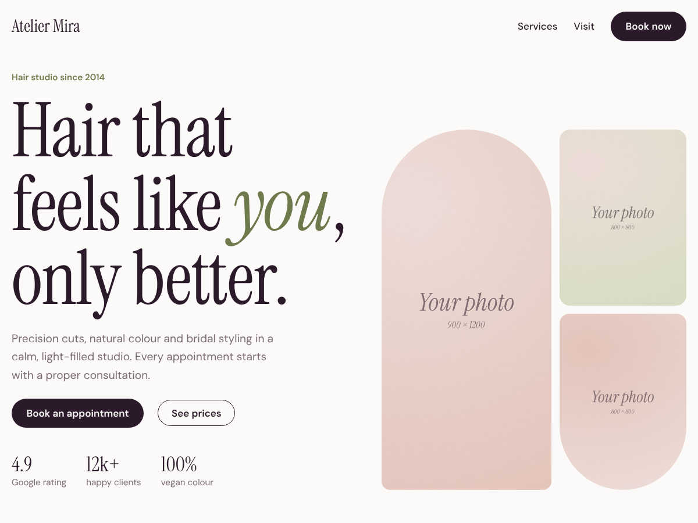

# Atelier Mira Lite

A calm, editorial WordPress block theme for hair salons, barbers and beauty studios.

The one-page home has a photo collage hero, a scrolling services band, a studio intro, a price menu with durations, and opening hours with a booking button. Everything is edited in the Site Editor – no page builder, no extra plugins.

- Full Site Editing block theme (WordPress 6.5+, tested with 7.1)
- 5 reusable patterns
- Fonts bundled with the theme (no Google Fonts requests)
- Mobile-first, full-screen phone menu
- Translation ready

## Install

1. Download this repository as a zip (Code → Download ZIP).
2. WordPress → Appearance → Themes → Add New Theme → Upload Theme → Activate.
3. Edit the home page in Appearance → Editor → Templates → Front Page.

## Atelier Mira (full version)

The full version adds team, gallery and review sections, an appointment request form and WooCommerce styles for gift cards and products.

**Live demo:** https://atelier-mira-wp.pages.dev
**Get it:** https://stavreva68.gumroad.com/l/atelier-mira-wordpress-theme

## License

GPL v2 or later. Fonts: SIL Open Font License 1.1. © 2026 Pavlina Stavreva.
